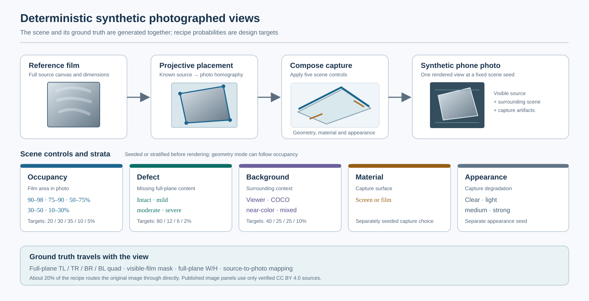
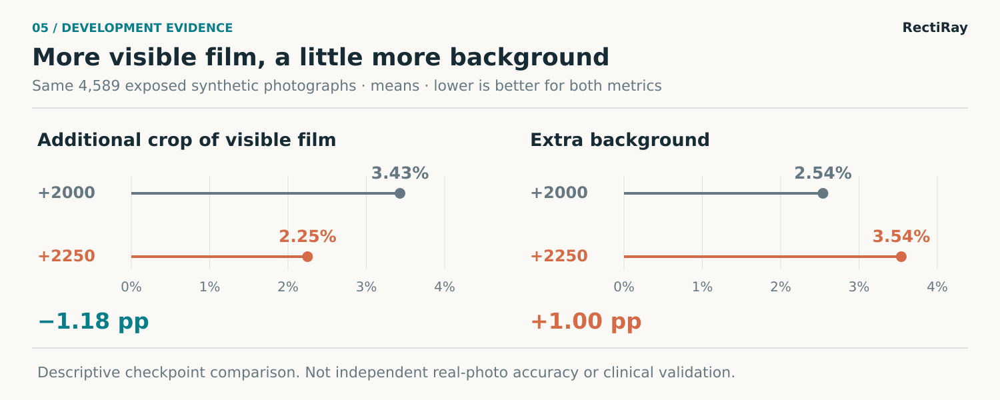
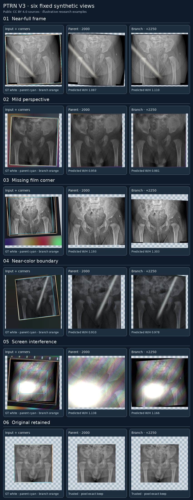

# PTRN Hip: rectifying photographs of hip radiographs

**Language:** English · [简体中文](i18n/README.zh-CN.md)

**Research status, 26 September 2026.** Branch **+2250** is a research candidate chosen after inspection of an exposed synthetic development set and previously viewed real photographs. It has not passed an independent real-photo evaluation, is not approved for clinical use, and is not an application model. “+2250” means 2,250 new optimizer updates after the parent `step-2000.pt`; it is distinct from an absolute step 2250 in the earlier run.

## Abstract

PTRN Hip studies extraction and projective rectification of the radiograph visible in a smartphone photograph. A DenseNet201 encoder and spatial decoder estimate an ordered quadrilateral, a full-plane width-to-height ratio, and an auxiliary visible-region mask. The renderer samples once from the original photograph. It preserves the photographed portion when the film extends beyond the frame without synthesizing unphotographed anatomy. The source inventory contains 4,620 files from three collections, of which 4,114 enter training. On 4,589 photographed views in an **exposed synthetic development set**, branch +2250 reduced mean additional crop from **3.43%** at branch +2000 to **2.25%**, while mean extra background increased from **2.54%** to **3.54%**. These measurements compare two research checkpoints on a known synthetic benchmark. They are not independent real-photo accuracy or evidence of clinical suitability.

## Method

The network accepts an aspect-preserving, letterboxed 224 × 224 RGB input normalized with ImageNet channel statistics. It reads four DenseNet201 feature scales, projects each to 64 channels, and fuses them spatially. A direct readout predicts **top-left, top-right, bottom-right, bottom-left** corners in input pixel-center coordinates; these corners may lie outside the photograph when the reference plane is only partly visible. A separate residual corrects the quadrilateral's edge-derived log aspect ratio. A visible-film mask supplies auxiliary training supervision. The mask does **not** perform a second crop or serve as an automatic approval gate.

The renderer maps only the intersection of the predicted plane and original photograph into a rectified canvas. It resamples the original photograph once, returning a validity mask for captured pixels. It does not invent absent anatomy. A trusted digital original can take a pixel-exact keep path, but that path requires trustworthy provenance: a label or the absence of extra cropping alone cannot establish that a file is a digital original. The current geometric contract and renderer are described in [visible-plane V3](docs/partial-v3.md); the [code map](docs/code-map.md) identifies the implementation.

## Data and synthetic scenes

The source inventory counts **files**, not unique patients. The local split retains the historical development files; duplicate and similarity review quarantined 28 files. It is **not** a patient-independent split.

| Source collection | Source files in the local inventory | Repository example policy |
| --- | ---: | --- |
| [MTDDH](https://www.nature.com/articles/s41597-025-05146-x) | 1,849 | Original-version redistribution terms have not been directly verified; excluded from repository examples. |
| [AV-DDH v2](https://data.mendeley.com/datasets/4gvcb6gmh2/2) | 2,417 | Source page states CC BY 4.0; eligible only after individual pixel and metadata review. |
| [Fraiwan DDH X-ray v2](https://data.mendeley.com/datasets/jf3pv98m9g/2) | 354 | Source page states CC BY 4.0; eligible only after individual pixel and metadata review. |
| **Total** | **4,620** | **4,114 train · 478 exposed development · 28 quarantine** |

The fixed development protocol produces 12 scenes per development file (**5,736 views**). It retains the earlier `partial-v3` scene recipe. The newer `ptrn-step2000-unified-v1` recipe applies to **training only**, so development comparisons use the same frozen scenes rather than a newly tuned test set. The local background pool comprises 4,400 COCO 2017 photographs and 1,100 procedurally generated interface images. COCO's annotations and website have a CC BY 4.0 license, while the photographs retain their respective Flickr terms; the pool is not redistributed by this repository. See [third-party sources and terms](THIRD_PARTY.md).

The following are **recipe targets**, not claims that the realized training stream attained every percentage. Geometry retries and feasibility constraints can change realized frequencies; they must be checked in the local scene audit. The 20% keep path is scheduled across training slots; the other probabilities are conditional on a photographed slot.

| Component | Target in the new training recipe |
| --- | --- |
| Source-image keep path | Approximately 20% of all views; photographed views approximately 80%. |
| Visible film area within photograph | 90–98%: 20%; 75–90%: 30%; 50–75%: 35%; 30–50%: 10%; 10–30%: 5%. |
| Photographed-plane missing area | None: 80%; 1–3%: 12%; >3–8%: 6%; >8–15%: 2%. |
| Background family | Generated viewer/interface: 40%; COCO context: 25%; near-color: 25%; mixed-color: 10%. |
| Source pre-crop | 12.5% of photographed views, with a 5–10% source-area loss target. |
| Capture appearance | Screen or physical film, with independently sampled interference and edge blending. |

The synthetic renderer treats source pre-crop, which defines a new complete reference plane, separately from cropping that occurs after photographing, which may place virtual reference corners outside the photo. The latter cannot be repaired by fabricating missing image content. The exact train-only probabilities and fixed development path are in [partial_data.py](src/ptrn_hip/partial_data.py).

## Training

The current branch starts from the verified parent pipeline checkpoint at **step 2000**, carrying its model and Adam state into a new run with a new deterministic sample cursor. It is not a bitwise continuation of the old sample stream. The planned ceiling is **3,000 additional updates**; checkpoints are numbered by additional branch steps and saved every 250 updates. The branch uses 224-pixel input, an actual and effective batch of 64, Adam with head learning rate 1 × 10⁻⁴, and frozen DenseNet201 encoder and BatchNorm statistics at `stage=head`. The loss combines corner regression, extra loss for missed visible film relative to extra background, invalid-geometry penalty, auxiliary visible-mask supervision, and full-plane ratio error. It does not apply a blanket penalty to corners outside the photo.

Every run binds the checkpoint to the recipe, source code, assets, optimizer and RNG state, and consumed sample cursor. The [reproduction guide](docs/reproducibility.md) provides setup and commands; the [checkpoint/source map](docs/checkpoint-source-map.md) records the audited SHA relationships. The renderer used for current visual review has an audited resampling update relative to training-time source. Therefore a current visualization is not presented as a pixel-identical replay of training-time rendering.

## Results

| Exposed development photographs, 4,589 views | Branch +2000 | Branch +2250 |
| --- | ---: | ---: |
| Mean **additional crop** of visible film | 3.43% | **2.25%** |
| Mean **extra background** in the predicted region | **2.54%** | 3.54% |

Additional crop is the fraction of truly visible film outside the predicted region. Extra background is the fraction of the predicted region outside the true visible-film mask. Both measures use synthetic ground truth and include the same 4,589 photographed views. The full fixed set contains 5,736 views; source-image keep views are excluded from this table so they do not dilute photograph behavior. The values are rounded from the audited aggregate of the completed fixed development evaluations. Their trade-off, rather than either number alone, motivated visual comparison. Branch +2250 remains a research candidate selected using exposed material.

The six examples deliberately cover near-full-frame capture, mild perspective, a missing corner, a near-color boundary, screen interference, and a preserved original. They are shown in a fixed order without removing unfavorable outcomes. The radiograph sources are drawn only from the two source pages marked CC BY 4.0 above; backgrounds are programmatically generated. The images are synthetic examples, not evidence of performance on independent phone photos. Source attribution, modifications, fixed seeds, and the pixel/metadata review are recorded in the [example credits and audit](docs/figures/examples/CREDITS.md).

## Limitations

The 478 development source files, all 5,736 fixed scenes, and 47 real photographs have been exposed during research. The real photographs lack a reliable paired reference for measuring true film loss, and their per-image review pages remain local. The source split is not known to separate patients; similarity candidates are not patient identities. A source dataset's posted license does not by itself resolve pixel text, privacy, or every downstream use. The method does not reconstruct unphotographed anatomy and may retain background or distort geometry, especially at ambiguous borders and partial capture. No independent real-photo or clinical validation has been completed.

The research checkpoints are private backups, separate from deployable model releases. Access to a private backup does not grant redistribution rights to its upstream initialization, training images, or fine-tuned weights. The application model has not been replaced. Paper-style presentation here does not imply a published hip-radiograph paper or a clinical claim.

## Reproduction and availability

For code-only checks, use Python 3.11 or 3.12, PyTorch, and Keras 3 with the PyTorch backend:

    uv venv --python 3.12
    uv pip install --python .venv/bin/python -e '.[dev]'
    CUDA_VISIBLE_DEVICES='' KERAS_BACKEND=torch .venv/bin/python -m pytest -q

Actual training and the fixed development evaluation require separately authorized local source images, background assets, initialization and parent checkpoints, and their hash-checked manifests. These are not in Git. Follow the [reproduction guide](docs/reproducibility.md) for the branch command, complete 5,736-view checks, and exact resume binding. `--eval-limit` is diagnostic only. Research backups, if accessible, are private Pre-releases and are not deployment registrations.

## References and attribution

1. Chong et al., [“Image Projective Transformation Rectification with Synthetic Data for Smartphone-captured Chest X-ray Photos Classification”](https://arxiv.org/abs/2210.05954), arXiv:2210.05954. The original PTRN study concerns chest photographs; this repository is a separate hip-radiograph research implementation.
2. Haddad et al., [AV-DDH, version 2](https://data.mendeley.com/datasets/4gvcb6gmh2/2), DOI: 10.17632/4gvcb6gmh2.2, CC BY 4.0 as stated on the dataset page.
3. Fraiwan et al., [A dataset of DDH X-ray images, version 2](https://data.mendeley.com/datasets/jf3pv98m9g/2), DOI: 10.17632/jf3pv98m9g.2, CC BY 4.0 as stated on the dataset page.
4. [MTDDH dataset publication](https://www.nature.com/articles/s41597-025-05146-x). The original dataset version's redistribution terms have not been directly verified for these repository examples.
5. COCO Consortium, [Dataset Terms of Use](https://github.com/cocodataset/cocodataset.github.io/blob/master/dataset/termsofuse.htm). COCO images follow their individual Flickr terms.
6. [THIRD_PARTY.md](THIRD_PARTY.md) records upstream code, initialization, data, and weight boundaries. The repository's [Apache-2.0 license](LICENSE) covers only code and documentation we can license.
