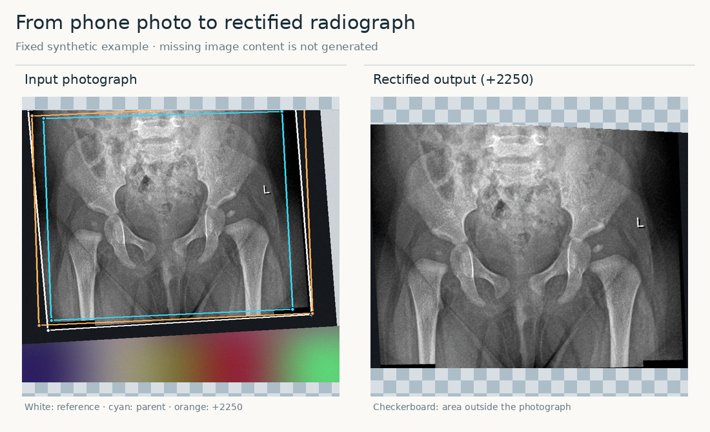
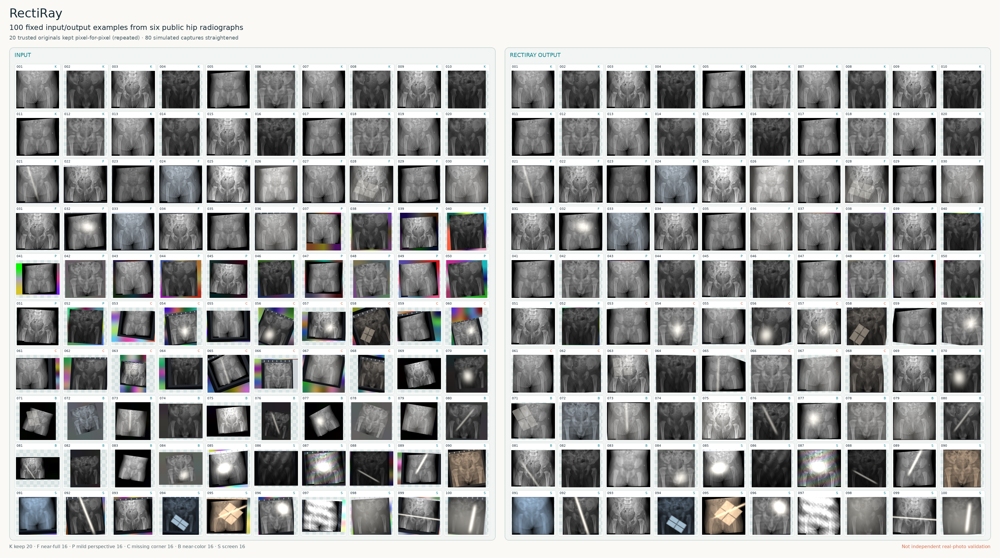
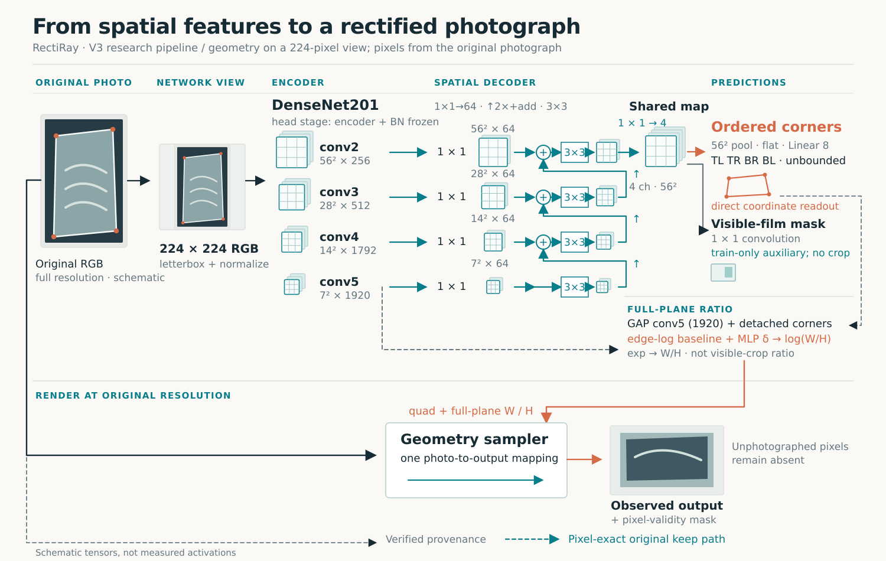

# RectiRay

**Turn a smartphone photograph of a hip X-ray into one straightened image of the part that was actually photographed.**

English · [简体中文](i18n/README.zh-CN.md)

> **Research prototype.** Synthetic examples and exposed development data inform this model. Independent real-photo and clinical validation are pending; the application model is unchanged.

## Input → output

<picture>
  <source media="(max-width: 600px)" srcset="docs/figures/examples/hero-missing-corner-mobile.png">
  
</picture>

*A fixed example made from an audited [public-source radiograph](docs/figures/examples/CREDITS.md). A corner is outside the photograph: RectiRay straightens the pixels it can see and leaves the unphotographed area empty. It does not draw missing anatomy.*

[Open the 100 pairs at full resolution](docs/figures/examples/contact-sheet-100.png) and match numbers across columns. They use **six audited public radiographs** in 100 fixed scenes, not 100 separate source films. Difficult outputs remain. No private phone photographs appear here; this is a visual demonstration, not an independent accuracy test. [Figure audit](docs/figures/README.md).

## How it works

1. **Locate the X-ray.** A network predicts four corners and the whole film plane's width-to-height ratio, including corners beyond a partial photo.
2. **Straighten what is visible.** The predicted geometry guides a single sampling operation on the **original-resolution photograph**. The output includes a mask showing which pixels were actually observed; missing image content is never generated.
3. **Protect verified originals.** A digital original with trustworthy provenance follows a pixel-exact keep path. The network does not decide provenance from appearance alone.

The model uses a **224 × 224** aspect-preserving, padded input. DenseNet201 features are fused spatially to predict the corners; a separate small component estimates the full-plane ratio. The visible-region mask helps training but never performs a second crop. [Geometry details](docs/partial-v3.md) and the [code map](docs/code-map.md) explain the exact interfaces.

## How it was trained

1. **Prepare the sources.** The local inventory holds **4,620 files** from [MTDDH](https://www.nature.com/articles/s41597-025-05146-x), [AV-DDH v2](https://data.mendeley.com/datasets/4gvcb6gmh2/2) and [Fraiwan DDH X-ray v2](https://data.mendeley.com/datasets/jf3pv98m9g/2): **4,114 for training, 478 for exposed development, and 28 quarantined** after duplicate or similarity review. These are file counts; patient independence is not established.
2. **Make training photographs.** Unchanged source files become simulated screen or film captures: mostly large, complete films, with some rotation, perspective, modest missing edges, near-color backgrounds, reflections and blur. The background pool has 4,400 COCO photos and 1,100 generated interfaces. Training also includes unchanged originals; pixel-exact keeping still requires verified provenance. The [scene diagram](docs/figures/synthesis.svg) and [recipe audit](docs/figures/README.md) distinguish targets from realized samples.
3. **Fit the geometry model.** At 224 pixels and batch 64, Adam (head rate **1 × 10⁻⁴**) trains the spatial decoder and output layers; DenseNet201 and BatchNorm stay frozen. Supervision covers corners, plane ratio, valid geometry and an auxiliary visible-film mask. The loss gives **missed visible film more weight than extra background**, matching the goal of retaining photographed anatomy.
4. **Check on fixed scenes.** Each development file has 12 frozen scenes (**5,736 views**) so models face the same synthetic questions. Real phone photos were also reviewed, but lack paired boundary truth and cannot serve as independent validation.

## Current measured result

On **4,589 photographed views from that exposed synthetic development set**, mean **additional crop of visible film was 2.25%** and mean **extra background inside the predicted region was 3.54%**. Both measurements use synthetic ground truth. Keep-original views are excluded from this denominator so they do not dilute photograph behavior. These values are not a real-photo success rate. [Definitions, historical comparisons and limitations](docs/figures/README.md).

## Reproduce and sources

The code and synthetic-only checks are available here; full training or evaluation needs separately authorized source images, backgrounds and weights that are **not in Git**. Start with the [reproduction guide](docs/reproducibility.md) for data layout, commands and expected outputs. The [research story](docs/research-journey.md) explains how real-photo review led us to revise the data recipe. This public source repository provides no model downloads. Research weights remain in a separate controlled private archive, not deployable or clinically validated models; the [checkpoint/source map](docs/checkpoint-source-map.md) preserves their hashes and source bindings.

The six illustrated films come only from AV-DDH v2 and Fraiwan v2, whose source pages state **CC BY 4.0**; each illustration underwent a separate pixel and metadata review. MTDDH's original-version redistribution terms have not been directly verified, so it is absent from repository illustrations. COCO photographs retain their individual Flickr terms and are not redistributed here. See [figure credits](docs/figures/examples/CREDITS.md), [third-party terms](THIRD_PARTY.md), and the [original PTRN chest-radiograph study](https://arxiv.org/abs/2210.05954). The [Apache-2.0 license](LICENSE) covers only code and documentation we can license.
