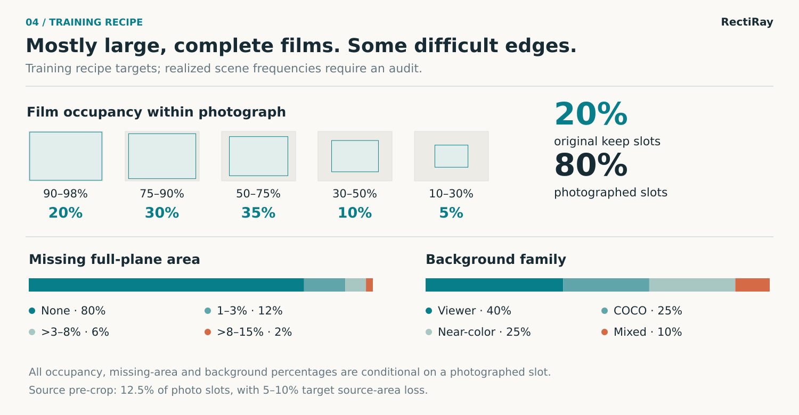

# RectiRay figure guide / 图表说明

[English README](../../README.md) · [中文首页](../../i18n/README.zh-CN.md)

RectiRay combines **Rectify** and **X-ray**. The repository is [wzxsph/RectiRay](https://github.com/wzxsph/RectiRay); existing `ptrn_hip` / `ptrn_pipeline` packages, CLI, checkpoint contracts, Release tags and asset filenames keep their identifiers for reproducibility.

RectiRay 来自 Rectify 与 X-ray，仓库已统一使用此名。代码包、CLI、检查点契约、Release tag 和资产文件名保留兼容标识。

## Figures / 图表

| Figure | English | 中文 | What it represents / 含义 |
| --- | --- | --- | --- |
| One worked example / 单例效果 | [Input → output](examples/hero-missing-corner.png) | [输入 → 输出](examples/zh-CN/hero-missing-corner.png) | Clean input regenerated from the same public case 03 scene; existing output pixels unchanged. / 同一公开案例 03 重新生成无叠加输入，原输出像素不变。 |
| 100 matched pairs / 100 组对照 | [Full-size sheet](examples/contact-sheet-100.png) | [完整总览](examples/zh-CN/contact-sheet-100.png) | RectiRay outputs on fixed scenes from six audited public sources; not 100 independent films. / 六张已审计公开源片的固定场景及 RectiRay 输出，不是 100 张独立母片。 |
| Network / 网络 | [Architecture](architecture.svg) | [架构图](i18n/architecture.zh-CN.svg) | Actual operator paths and tensor dimensions; drawn maps are schematic, not learned activations. / 真实算子路径及张量尺寸，所绘特征图为示意而非网络激活。 |
| Partial capture / 局部入镜 | [Geometry](geometry.svg) | [几何说明](i18n/geometry.zh-CN.svg) | A projective lattice illustrates full-plane versus visible support. / 用透视网格解释完整平面与实际可见区域的区别。 |
| Scene construction / 场景构建 | [Synthesis](synthesis.svg) | [合成流程](i18n/synthesis.zh-CN.svg) | Schematic geometry/background/appearance stages; not actual training images. / 几何、背景、外观的概念示意，不冒充训练样本。 |
| Training targets / 训练目标分布 | [Recipe](recipe.svg) | [配方分布](i18n/recipe.zh-CN.svg) | Requested probabilities, not an audit of realized samples. / 配方概率，不是实际频率审计。 |
| Development comparison / 开发集对照 | [Trade-off](tradeoff.svg) | [取舍图](i18n/tradeoff.zh-CN.svg) | Same 4,589 exposed synthetic photos, both crop and background shown. / 同一批 4,589 个已暴露合成拍摄视图，同时呈现裁损与残留背景。 |

## Rebuild / 重新生成

The schematic SVG generators use the Python standard library. The teaser also needs Pillow and DejaVu Sans / Noto Sans CJK SC fonts. CairoSVG is optional for local raster preview; it is not a runtime or training dependency.

概念 SVG 使用 Python 标准库生成；单例主图另需 Pillow 和中英文字体。CairoSVG 只用于本地预览，不是模型运行依赖。

```bash
python tools/build_architecture_figure.py
python tools/build_research_figures.py
python tools/build_readme_hero.py
```

The hero generator checks the clean input pixel hash and the existing output panel hash before exporting metadata-free RGB PNGs. Rebuild the clean input with `KERAS_BACKEND=torch PYTHONPATH=src python tools/build_readme_hero.py --av-root "$AV_V2_RAW"`: this uses the same case 03 source, seed, geometry and capture effects, without corner overlays or model inference. The default command needs only the committed public images. Its desktop and narrow-screen layouts use the same pixels. The six full comparison panels remain unchanged; [credits and audit](examples/CREDITS.md) identify their source datasets, alterations, seeds and weight SHA values. Font rasterization can change PNG bytes across machines without changing those image rectangles.

主图生成器校验干净输入的像素 SHA 与既有输出源图 SHA，导出无元数据的 RGB PNG。`--av-root` 可用同一公开案例 03 的素材与种子重新合成无框输入，不加载权重或重新推理；默认命令只读取仓库已审计图片。桌面与窄屏版本采用同一影像区。原来的六例详细对照保持不变，来源与修改记录见[中文审计](examples/zh-CN/CREDITS.md)。字体环境可能改变文字栅格化与文件 SHA，但不改变复制的影像区。

Generating the 100-scene sheet additionally requires the authorized source image copies, verified +2250 checkpoint, initialization/bundle bindings and a suitable local inference environment. These assets are not in Git. See `python tools/build_public_contact_sheet.py --help` for path arguments. It does not download private assets, train a model or use the 47 real phone photographs. The detailed audit is written only to an ignored local work directory; individual thumbnails are assembled in memory. The repository contains just the two aggregate sheets and the generation code.

100 场景图需要获授权的源片、+2250 权重、初始化与 bundle 绑定，以及本地推理环境；这些资产不在 Git 内。生成器不训练、不调用 47 张私人实拍。逐图缩略图在内存中拼接，详细审计只写本地忽略目录；仓库只保存两版总览及生成代码。

## 100-scene recipe and audit / 100 场景配方与审计

The fixed sheet contains **20 trusted-original slots** (repeated references to the same six sources) and **16 each** of near-full-frame capture, mild perspective, missing corner, near-color edge and screen interference. This deliberately balanced illustration is not drawn in the training recipe's proportions. The six parent source images and privacy alterations are exactly those listed in [the existing credits](examples/CREDITS.md); only procedural backgrounds are used.

总览固定为 20 个可信原片槽位（重复引用同六张源片），加上近满幅、轻透视、缺角、近色融边及屏幕干扰各 16 个。为便于观察而平衡各类，**并非按训练分布随机抽样的测试集**。源片与匿名化处理复用既有审计，仅使用程序背景。

Scene IDs are 001–100; the base seed is `2026092700 + ID`. Infeasible geometry retries use a fixed stride of `104729`, with at most 12 attempts before emitting a labeled failure slot. Near-full scenes use the three audited AV-DDH sources because the square Fraiwan images cannot realize all of that framing range in the existing generator. The order, source assignment and retries are determined before prediction, never from model quality. The checked-in run required a first-seed retry for 13 scenes (up to 10 retries); all 100 slots have an image, including difficult outcomes. **Producing an output is not a quality pass.**

编号、母片分配与几何重试均在推理前确定，不根据模型结果选图。13 个场景的首个几何种子不可行，最多经过 10 次重试。100 个槽位全部有图，其中 80 次调用 +2250 展平、20 次可信原片旁路。**有输出不等于通过取图质量验收。**

The checkpoint SHA is `35f0101260b19ee1484022de3a4ed40fd3ce2f4bdb0ef73f379c4fd458a53b3b`; the reviewed renderer SHA is `a23bb919dd5cea1437477b0cb6478247e6bf9735599962787d7b48e42ef92549`. Source, checkpoint and bundle bindings were checked before local CUDA inference. The initial inference run was rebuilt twice with identical output hashes. The current sheets only redraw those captions; the 200 numbered picture cards are pixel-identical to the initial run. All 200 picture cells are pixel-identical across locales; exported PNGs have no EXIF or other embedded metadata. The full-resolution sheets are 3440 × 1920, with aspect-preserving 150 × 130 picture cells.

| File | SHA256 |
| --- | --- |
| English PNG | `3ac41a6cca14109ce0b407e66bbe77e827db2583bd82f5ebb5fe053d65c225a6` |
| 中文 PNG | `9c530207b80ce2691007a26bc06d3f347e326628f1a7a98860ad567b3dabdea7` |

初版已通过同环境完整重建；当前版本仅重绘文字，中英文 200 个带编号影像卡片与初版逐像素一致，PNG 无嵌入元数据。字体、Pillow 或 GPU 数值环境变化可能影响重新生成的文件字节。生成方法与限制相同不等于跨环境逐字节一致。

## Caption-only rebuild / 只重绘文字

No source images, model, or GPU are needed. The generator refuses any changed picture card (including its ID). All 200 cards share the decoded SHA256 `0725988ebad26eed2602114f50f7c2c08ba4ceda93d4031db489135f89d38486` across both languages and before/after this caption update.

不读取原片、不运行模型。脚本逐个检查全部编号和影像卡片，文字改版前后及中英文版本逐像素一致。

```bash
python tools/build_public_contact_sheet.py --caption-only \
  --reference-revision 0a7ea9977efaa967f7a2aaee7f186651d88fbd4c \
  --output-en docs/figures/examples/contact-sheet-100.png \
  --output-zh docs/figures/examples/zh-CN/contact-sheet-100.png \
  --local-report .local/contact-sheet-caption-audit.json
```

## Exact training targets / 精确训练目标

These are recipe targets, not realized frequencies. Geometry feasibility and retries can change measured proportions. Only the keep/photo rate is over all slots; the remaining rows are conditional on a photographed slot. / 以下是目标概率，不是实际频率；除原片／拍摄比例外，其余均以拍摄视图为分母。

| Component / 项目 | Target / 目标 |
| --- | --- |
| Original / 原片保留 | About 20% of all slots; photos about 80% / 约 20% 原片、80% 拍摄 |
| Film occupancy / 片区占幅 | 90–98%: 20%; 75–90%: 30%; 50–75%: 35%; 30–50%: 10%; 10–30%: 5% |
| Missing full-plane area / 片面缺损 | None / 无: 80%; 1–3%: 12%; >3–8%: 6%; >8–15%: 2% |
| Background / 背景 | Viewer / 界面: 40%; COCO: 25%; near-color / 近色: 25%; mixed-color / 混色: 10% |
| Source pre-crop / 母片预裁剪 | 12.5% of photo slots; target loss 5–10% of source area / 拍摄槽位的 12.5%，目标裁去 5–10% 母片面积 |

Source pre-crop defines a new complete reference plane; cropping after projection instead removes photographed support. The fixed 5,736 development scenes retain their original recipe. / 母片预裁剪定义新的完整参考平面，投影后裁剪才是照片没有拍到的缺损；固定开发集仍使用原先配方。



[中文配方图](i18n/recipe.zh-CN.svg) · [Training and resume commands / 训练与恢复](../reproducibility.md)

## Historical comparisons / 历史对照

The same **4,589 exposed synthetic photographed development views** are used below. Additional crop is visible film omitted from the predicted region, divided by true visible-film area. Extra background is area outside the true visible-film mask, divided by predicted region area. These use synthetic ground truth, not independent real-photo accuracy. / 同一批 **4,589 个已用于开发的合成拍摄视图**；新增裁损以真实可见片区为分母，残留背景以预测区域为分母，不代表独立实拍准确率。

| Checkpoint / 检查点 | Mean additional crop / 平均新增裁损 | Mean extra background / 平均残留背景 |
| --- | ---: | ---: |
| +2000 | 3.43% | 2.54% |
| +2250 (RectiRay example weights / 示例权重) | 2.25% | 3.54% |


[中文取舍图](i18n/tradeoff.zh-CN.svg) · [Exact checkpoint bindings / 精确权重绑定](../checkpoint-source-map.md)

<details>
<summary>Six historical three-column examples / 六例历史三栏对照</summary>


[中文版](examples/zh-CN/overview.webp) · [Source and renderer audit / 来源与渲染器审计](examples/CREDITS.md)

</details>

## Technical and visual sources / 技术与版式依据

- Network paths and dimensions: [partial_model.py](../../src/ptrn_hip/partial_model.py), [spatial_model.py](../../src/ptrn_hip/spatial_model.py), [ratio residual](../../src/ptrn_hip/spatial_objectives.py). The auxiliary mask supervises training; it does not crop the result a second time.
- Geometry: [partial_geometry.py](../../src/ptrn_hip/partial_geometry.py) and the [visible-plane contract](../partial-v3.md). Unphotographed content is invalid, not synthesized. Full-plane ratio is distinct from the visible canvas aspect ratio.
- Recipe: [partial_data.py](../../src/ptrn_hip/partial_data.py); the newer branch recipe changes training only. The fixed 5,736-view development set keeps its earlier recipe.
- Evidence: the historical checkpoint comparison above; the homepages show only the selected result. Additional crop is 3.43% → 2.25%; extra background is 2.54% → 3.54%. These are descriptive results on exposed synthetic photographs, not independent real-photo accuracy.

The reader order and use of operator diagrams / compact image grids were informed by the official [DocScanner](https://github.com/fh2019ustc/DocScanner), [DUSt3R](https://github.com/naver/dust3r), [Depth Anything V2](https://github.com/DepthAnything/Depth-Anything-V2) and [Restormer](https://github.com/swz30/Restormer) READMEs. No graphics, model results, authorship, benchmark claims or paper badges are copied from them. RectiRay's diagrams are drawn from this repository's implementation.

版式参考这些官方仓库的阅读顺序、算子图及紧凑输入输出网格；没有复制它们的图片、实验结果、作者信息或论文徽章。RectiRay 架构图依据本仓库实现绘制。
