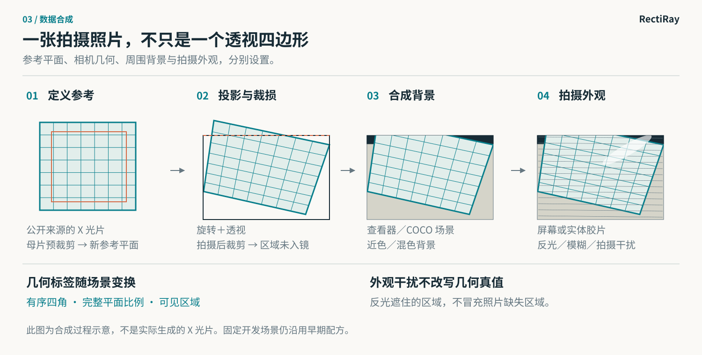
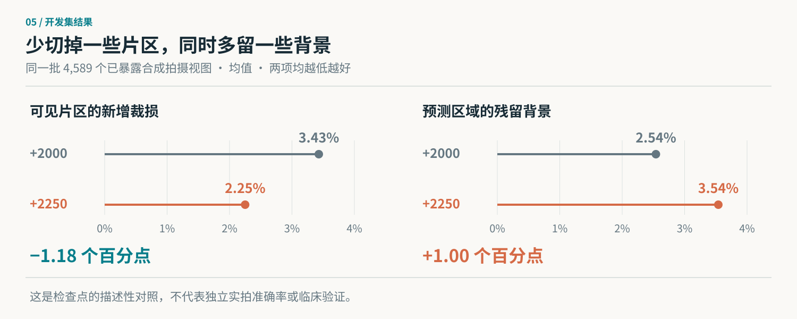
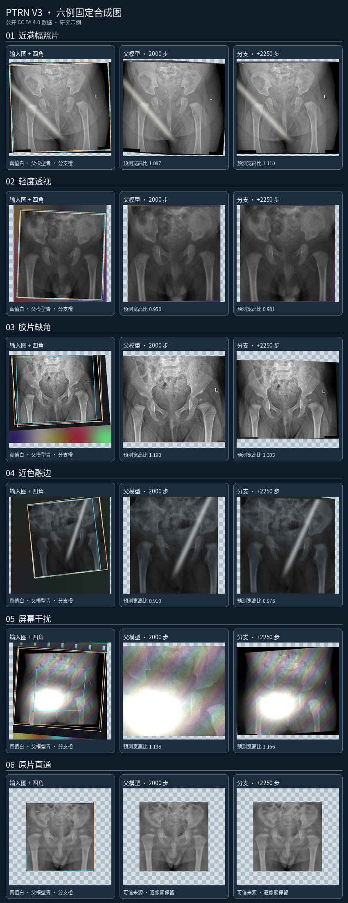

# PTRN Hip：髋关节 X 光片翻拍照片取图研究

**语言：**[English](../README.md) · 简体中文

**研究状态，2026 年 9 月 26 日。**分支 **+2250** 是查看已暴露合成开发集和先前看过的实拍照片后选出的研究候选。它尚未通过独立实拍评估，未获临床使用准入，也不是应用模型。“+2250”表示从父权重 `step-2000.pt` 再进行 2,250 次优化更新，不能与旧训练绝对步数 2250 混称。

## 摘要

PTRN Hip 研究从手机照片中提取并透视校正实际拍到的髋关节 X 光片。DenseNet201 编码器和空间解码器预测有序四角、完整参考平面的宽高比，以及用于辅助监督的可见区域掩码。取图器只从原照片采样一次。胶片超出照片边界时，它保留拍到的部分，不补造未拍到的解剖影像。三个来源的清单共含 4,620 个源文件，其中 4,114 个进入训练。在**已暴露合成开发集**的 4,589 个拍摄视图上，分支 +2250 的平均新增裁损由分支 +2000 的 **3.43%** 降至 **2.25%**，平均残留背景同时由 **2.54%** 升至 **3.54%**。这些数字只比较同一已知合成基准上的两个研究检查点，不能解释为独立实拍准确率或临床适用性证据。

## 方法

网络输入是等比例补边至 224 × 224 的 RGB 图，按 ImageNet 通道统计量归一化。它读取 DenseNet201 的四个尺度特征，各投影为 64 通道后进行空间融合。直接读出头按**左上、右上、右下、左下**顺序预测输入像素中心坐标中的四角；参考平面只有部分入镜时，四角可以落在照片范围外。独立残差头修正从四边推得的对数宽高比。可见片区掩码只用于辅助训练监督，**不负责二次裁剪**，也不是自动准入门禁。

取图器将预测参考平面与原照片相交，只把交集映射到摆正后的画布。它从原照片采样一次，并返回表示实际拍到像素的有效掩码；不会补造未拍到的骨骼影像。可信数字原片可以走逐像素保留路径，但前提是来源可信：仅有标签、或没有启用额外裁剪，都不能证明某张文件是数字原片。当前几何契约和取图器见[可见平面 V3](../docs/partial-v3.md)，实现入口见[代码地图](../docs/code-map.md)。

## 数据与合成场景

来源表统计的是**文件数**，不是独立患者数。本地划分保留历史开发文件，并将重复及相似性待审的 28 个文件隔离；**不能称为患者独立切分**。

| 来源 | 本地清单中的源文件数 | 仓库示例使用原则 |
| --- | ---: | --- |
| [MTDDH](https://www.nature.com/articles/s41597-025-05146-x) | 1,849 | 尚未直接核实原始版本的再分发条款；不用于仓库效果图。 |
| [AV-DDH v2](https://data.mendeley.com/datasets/4gvcb6gmh2/2) | 2,417 | 数据集页面标注 CC BY 4.0；逐张审查像素及元数据后才可用于示例。 |
| [Fraiwan DDH X-ray v2](https://data.mendeley.com/datasets/jf3pv98m9g/2) | 354 | 数据集页面标注 CC BY 4.0；逐张审查像素及元数据后才可用于示例。 |
| **合计** | **4,620** | **训练 4,114 · 已暴露开发 478 · 隔离 28** |

固定开发协议对每个开发源文件生成 12 个场景，共 **5,736 个视图**，仍使用旧的 `partial-v3` 场景配方。新的 `ptrn-step2000-unified-v1` 配方**仅用于训练**；因此检查点在相同冻结场景上比较，而不是新调配出的测试集。本地背景池有 4,400 张 COCO 2017 照片和 1,100 张程序生成的界面图。COCO 标注及网站使用 CC BY 4.0，照片则遵循各自的 Flickr 条款；本仓库不再分发这个背景池。详见[第三方来源与条款](../THIRD_PARTY.md)。

下表为**新训练配方目标**，不能据此声称实际训练流完全达到每档比例。几何重试和可行性限制可能改变实测频率，须以本地场景审计为准。约 20% 的原片保留路径按训练槽位安排；其余概率以“该槽位是拍摄图”为条件。

| 项目 | 新训练配方目标 |
| --- | --- |
| 源片保留路径 | 全部视图约 20%；拍摄图约 80%。 |
| 照片内可见片区占幅 | 90–98%：20%；75–90%：30%；50–75%：35%；30–50%：10%；10–30%：5%。 |
| 拍摄后参考平面缺损 | 无缺损：80%；缺 1–3%：12%；缺 >3–8%：6%；缺 >8–15%：2%。 |
| 背景家族 | 程序生成的查看器／界面：40%；COCO 场景：25%；近色：25%；混色：10%。 |
| 母片预裁剪 | 拍摄图的 12.5%，目标裁去源片面积的 5–10%。 |
| 拍摄外观 | 屏幕或实体胶片，独立采样干扰和边缘混合。 |

合成器区分母片预裁剪和拍摄后裁损。前者重新定义一张完整参考平面；后者可能让完整参考平面的虚拟四角落在照片外，不能靠补画缺失影像来修复。训练专用概率和冻结开发路径的准确实现见 [partial_data.py](../src/ptrn_hip/partial_data.py)。

## 训练

当前分支以已核对的正式流水线 **step 2000** 权重为父模型，在新的确定性样本游标上继承其模型及 Adam 状态。这不是旧样本流的逐位续训。计划上限为再训练 **3,000 个更新步**，每 250 步保存检查点；分支编号表示新增步数。配置为 224 输入、实际及有效 batch 均为 64、Adam 的头部学习率 1 × 10⁻⁴、`stage=head` 下冻结 DenseNet201 编码器和 BatchNorm 统计量。损失包含四角回归、对可见影像漏裁高于多余背景的惩罚、无效几何惩罚、辅助可见掩码监督和完整平面比例误差；它不对照片外四角统一施加惩罚。

每次运行将检查点与配方、源码、资产、优化器及随机数状态、实际消费样本游标绑定。[复现指南](../docs/reproducibility.md)提供环境和命令；[权重与源码对应表](../docs/checkpoint-source-map.md)记录已审计的 SHA 关系。当前目视审阅使用的取图器相对于训练时源码有经审计的重采样更新，因此当前可视化不能称为训练当时渲染的逐像素重放。

## 结果

| 已暴露开发集拍摄图，4,589 个视图 | 分支 +2000 | 分支 +2250 |
| --- | ---: | ---: |
| 可见影像的平均**新增裁损** | 3.43% | **2.25%** |
| 预测区域内的平均**残留背景** | **2.54%** | 3.54% |

新增裁损指真实可见片区落在预测区域外的比例；残留背景指预测区域中落在真实可见片区外的比例。两项均依靠合成真值，并使用同一批 4,589 个拍摄视图。固定开发全集有 5,736 个视图；本表排除源片保留视图，避免稀释拍摄图表现。数值由已完成的固定开发评估聚合后四舍五入得到。正是两项指标之间的取舍促使进一步目视比较，不能只看其中一项。分支 +2250 仍是使用已暴露资料选出的研究候选。

六例按固定顺序展示近满幅、轻透视、缺角、近色融边、屏幕干扰和原片保留；不会因结果不理想而删样本。源 X 光片只来自上表中页面标注 CC BY 4.0 的两套数据，背景由程序生成。它们是合成示例，不能证明对独立手机照片的效果。来源署名、合成改动、固定种子及像素／元数据审查记录见[中文版示例署名与审计](../docs/figures/examples/zh-CN/CREDITS.md)。

## 局限

478 个开发源文件、全部 5,736 个固定场景，以及 47 张实拍都已用于研究。实拍没有可靠的成对参考边界，无法从中计算真实漏片率；逐例审阅网页只留本地。现有文件划分并未证明患者互斥，相似性候选也不能当作患者身份。数据集页面的许可标注本身不足以证明像素文字、隐私和所有下游用途都已满足要求。此方法不会重建未拍到的解剖结构，在模糊边界和局部入镜时仍可能保留背景或产生几何形变。尚未完成独立实拍或临床验证。

研究检查点存放为私有备份，与可部署模型 Release 分开。能够访问私有备份，不代表获得上游初始化、训练影像或微调权重的再分发权。应用模型没有替换。本文采用论文式排版，不表示髋片研究论文已发表，也不构成临床声明。

## 复现与可用性

仅运行代码检查时，使用 Python 3.11 或 3.12、PyTorch 及 PyTorch 后端的 Keras 3：

    uv venv --python 3.12
    uv pip install --python .venv/bin/python -e '.[dev]'
    CUDA_VISIBLE_DEVICES='' KERAS_BACKEND=torch .venv/bin/python -m pytest -q

实际训练和固定开发评估还需要另行获准使用的本地源片、背景、初始化与父权重，以及已核 SHA 的清单。这些资产不在 Git 中。按[复现指南](../docs/reproducibility.md)执行分支命令、5,736 视图完整核验和精确恢复绑定。`--eval-limit` 只用于诊断。私有研究备份即使可访问，也不登记为部署模型。

## 参考资料与署名

1. Chong 等，[《Image Projective Transformation Rectification with Synthetic Data for Smartphone-captured Chest X-ray Photos Classification》](https://arxiv.org/abs/2210.05954)，arXiv:2210.05954。原 PTRN 研究对象为胸片翻拍；本仓库是单独的髋片研究实现。
2. Haddad 等，[AV-DDH 第 2 版](https://data.mendeley.com/datasets/4gvcb6gmh2/2)，DOI: 10.17632/4gvcb6gmh2.2；数据集页面标注 CC BY 4.0。
3. Fraiwan 等，[DDH X-ray 图像数据集第 2 版](https://data.mendeley.com/datasets/jf3pv98m9g/2)，DOI: 10.17632/jf3pv98m9g.2；数据集页面标注 CC BY 4.0。
4. [MTDDH 数据集论文](https://www.nature.com/articles/s41597-025-05146-x)。本仓库示例尚未直接核实该数据集原始版本的再分发条款。
5. COCO Consortium，[数据集使用条款](https://github.com/cocodataset/cocodataset.github.io/blob/master/dataset/termsofuse.htm)。COCO 照片遵循各自的 Flickr 条款。
6. [THIRD_PARTY.md](../THIRD_PARTY.md)记录上游源码、初始化、数据和权重的使用边界。本仓库的 [Apache-2.0 许可](../LICENSE)只覆盖我们有权授权的代码和文档。
