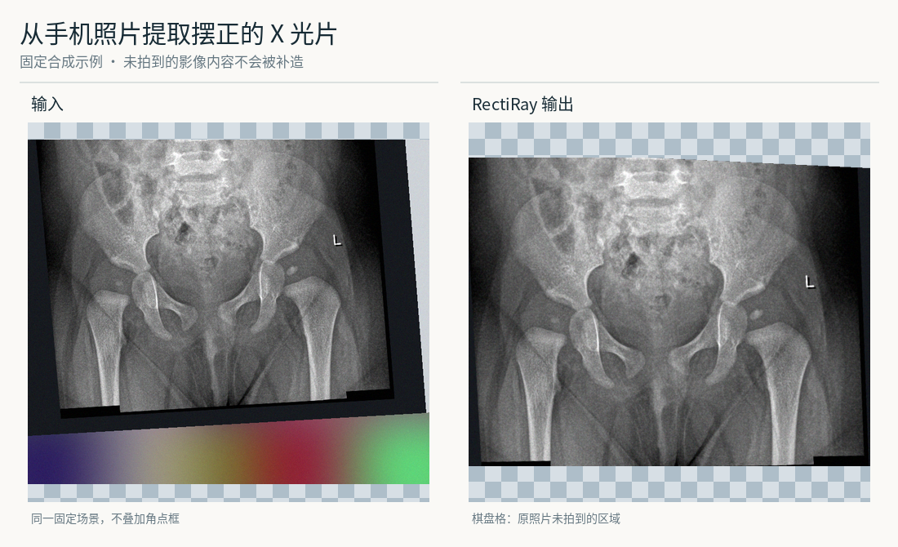
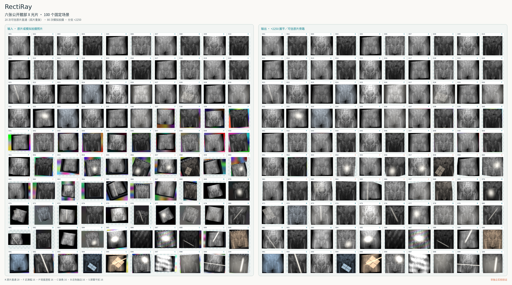
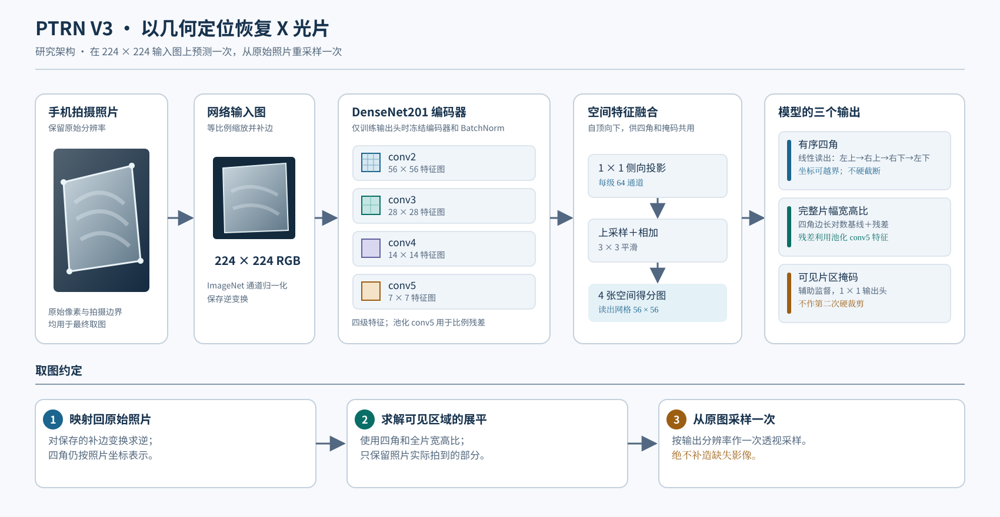

# RectiRay

**把手机拍摄的髋关节 X 光片照片，变成一张摆正的、只包含实际拍到内容的影像。**

[English](../README.md) · 简体中文

> **研究原型。** 下列效果图是合成示例；开发集已经参与选模。尚未完成独立实拍或临床验证，也没有替换应用模型。

## 输入 → 输出

<picture>
  <source media="(max-width: 600px)" srcset="../docs/figures/examples/zh-CN/hero-missing-corner-mobile.png">
  
</picture>

*这张固定示例使用经过审查的[公开源片](../docs/figures/examples/zh-CN/CREDITS.md)。片子有一角没有进入照片：RectiRay 只摆正实际拍到的像素，让未拍到的区域保持空白，不补造缺失的解剖影像。*

[打开原分辨率的 100 组对照](../docs/figures/examples/zh-CN/contact-sheet-100.png)，按左右相同编号查看。这些图由**六张已审查的公开源片**生成 100 个固定场景，并非 100 张不同源片；困难结果也保留在图中。总览不含私人手机照片，只展示视觉效果，**不是独立准确率测试**。[图像构造与审计](../docs/figures/README.md)。

## 工作原理

1. **找到 X 光片。** 网络预测四个角和完整片面宽高比。胶片只有一部分入镜时，参考角点也可以落在照片之外。
2. **摆正可见部分。** 预测几何指导取图器从**原分辨率照片**采样一次；输出同时记录哪些像素真的被拍到。未拍到的影像不会被生成。
3. **保护可信原片。** 来源已核实的数字原片走逐像素保留路径。网络不能仅凭外观平整就认定来源可信。

照片先等比例缩放并补边至 **224 × 224**。DenseNet201 的空间特征用于预测四角，另一小模块估计完整片面的比例。可见区域掩码用于辅助训练，**不执行第二次裁剪**。接口细节见[几何协议](../docs/partial-v3.md)和[代码地图](../docs/code-map.md)。

## 训练过程

1. **准备源片。** 本地清单共有 **4,620 个文件**，来自 [MTDDH](https://www.nature.com/articles/s41597-025-05146-x)、[AV-DDH v2](https://data.mendeley.com/datasets/4gvcb6gmh2/2) 和 [Fraiwan DDH X-ray v2](https://data.mendeley.com/datasets/jf3pv98m9g/2)：**训练 4,114、已暴露开发 478、重复或相似性待审而隔离 28**。这是文件数，尚未证明患者互斥。
2. **合成拍摄照片。** 源片文件保持不变，合成屏幕或实体胶片拍摄场景：以占幅较大、内容完整的片子为主，适量加入旋转、透视、轻度缺边、近色背景、反光与模糊。背景池有 4,400 张 COCO 照片和 1,100 张程序界面图。训练也包含未经形变的原片，但逐像素保留动作仍要求来源可信。[场景合成图](../docs/figures/i18n/synthesis.zh-CN.svg)及[配方审计](../docs/figures/README.md)区分目标比例与实际样本。
3. **训练几何模型。** 输入尺寸为 224、batch 为 64；Adam 的头部学习率为 **1 × 10⁻⁴**，训练空间解码器和输出层，冻结 DenseNet201 编码器与 BatchNorm。四角、片面比例、几何有效性和辅助可见掩码共同监督训练。损失对**漏掉已拍到的片区**赋予高于多留背景的代价，呼应完整取图的目标。
4. **用固定场景检查。** 478 个开发文件各对应 12 个冻结场景，合计 **5,736 个视图**，使模型面对同一批合成问题。实拍照片另行做了人工审阅，但它们没有成对的准确边界，也已参与研究，不能作为独立验证。

## 当前测得的结果

在已暴露合成开发集的 **4,589 个拍摄视图**上，平均**新增裁损为 2.25%**，平均**预测区域内残留背景为 3.54%**。两项均依据合成真值计算；分母排除了原片保留视图，以免稀释拍摄图表现。这**不是实拍成功率**。[指标定义、历史对照与限制](../docs/figures/README.md)。

## 复现与来源

仓库提供源码及不依赖病例图的合成检查；完整训练或评估仍需另行获授权的源片、背景和权重，**这些都不在 Git 中**。从[复现指南](docs/reproducibility.zh-CN.md)查看数据目录、命令和预期产物；[研究历程](docs/research-journey.zh-CN.md)解释实拍审阅如何促使我们调整数据配方。研究权重是私有备份，不是可部署或已获临床验证的模型。

示例影像只选自 AV-DDH v2 和 Fraiwan v2；其页面标注 **CC BY 4.0**，入图素材又经过逐张像素与元数据审查。MTDDH 原始版本的再分发条款尚未直接核实，因此仓库效果图不使用它。COCO 照片遵守各自的 Flickr 条款，也不随仓库分发。详见[效果图署名](../docs/figures/examples/zh-CN/CREDITS.md)、[第三方条款](../THIRD_PARTY.md)及[最初的 PTRN 胸片研究](https://arxiv.org/abs/2210.05954)。[Apache-2.0 许可](../LICENSE)只覆盖本仓库有权授权的源码与文档。
